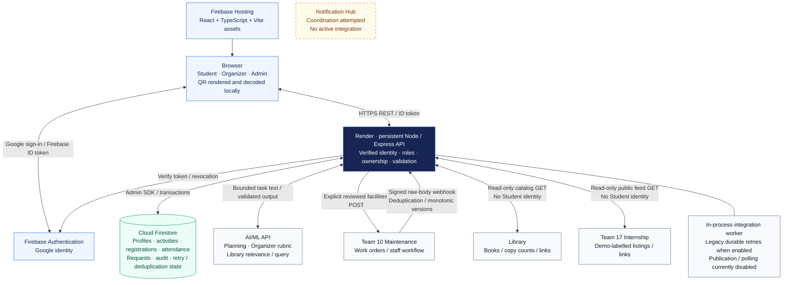

# Implemented platform architecture

Updated 9 November 2026. [Standalone SVG](platform-architecture.svg) ·
[Full explanation](../architecture.md). Arrows show implemented data paths;
Notification Hub is outside them.

No browser-to-Firestore data path exists. Client rules deny access; server
authorization protects Admin SDK operations. Partner/AI keys stay server-only.
Admin has no event CRUD, roster or check-in powers. The worker is persistent;
it does not auto-send saved facilities notes. Render idle sleep limits availability.

Partner completion is user-confirmed on 9 November, not new captured execution
evidence. Maintenance is the main showcase; Library/Internship are read-only;
Notification Hub remains an attempted connection.
